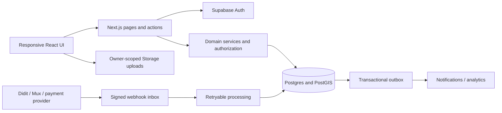

# Rentral Architecture and Delivery Plan

> **Historical plan — current scope supersedes this document (2026-11-09).**
> Read the user-approved [completion blueprint](remaining-work-blueprint.md) and
> [31-area current status matrix](completion-status.md) first. The active stack is
> Expo Android/iOS, npm, local Next.js, MongoDB/JWT and private local storage;
> personal KYC onboarding is removed and Paystack is the sole payment provider.
> Supabase/PostGIS/OAuth/Didit initiation, OPay, historical migration commands,
> bypass flags and earlier provider-completion labels below are retained evidence,
> not current setup instructions. The original PostgreSQL database stays untouched.
> Use [environment setup](environment-setup.md) and [current progress](progress-tracker.md)
> for configuration and actual checks. Source completion does not establish real
> provider/device acceptance or a production release.

## Historical evidence begins here

Current environment instruction (2026-11-07): staging was cancelled; use
`.env.local`. The user explicitly declined the twelve pending migrations to its
hosted Supabase database: keep that database unchanged and do not re-request the
update. See `local-development.md` for verified configuration. Continue isolated
local fixture tests; keep schema-dependent/provider gates off. No hosted update
was performed.

> Implementation checkpoint 2026-11-07: many proposed entities and screens below
> now have migration-backed, gated implementations. Read
> [release readiness](release-readiness.md), [completion plan](completion-plan.md)
> and [staging setup](staging-setup.md) for the current code and acceptance state.
> Provider custody, OPay, actual refunds/payouts and hold-credit conversion remain
> incomplete. Historical milestone descriptions are not production acceptance.

Reviewed: 2026-09-24. This plan distinguishes current code from the target product.
It supersedes conflicting implementation examples in older context documents.
It is an engineering plan, not a claim of certification or production readiness.

## Product and Terms

Rentral is a Lagos-first marketplace for property, vehicle, and boat rentals.
Identity, listing provenance, reservations, payments, and dispute handling are
separate trust boundaries, even though customers experience a single application.

- Authenticated: Supabase has validated the user's session.
- Verified: the current server-owned identity decision permits protected activity.
- Active listing: publication requirements have all passed, including any required payment.
- Escrow: a provider-supported custody/settlement arrangement; an internal status alone does not establish one.
- Complete milestone: working UI, server authorization, persistence, error paths, tests, and documentation; a mock is not completion.

## Application Structure

Keep a modular monolith in Next.js 16 and TypeScript strict mode. The current team
and workload do not justify distributed services. Extract workers only for durable
asynchronous tasks such as media processing, webhook retries, and expiration jobs.

Existing `app/actions`, `lib`, `components`, and `store` remain the module boundaries.
Introduce `lib/identity`, `lib/listings`, `lib/bookings`, `lib/payments`, and
`lib/messaging` as those domains grow; avoid moving working files solely for naming.
Routes stay under `/marketplace` for listings and profiles, with `/sign-in`,
`/forgot-password`, `/reset-password`, `/onboarding`, and `/auth/callback` for identity.

Pages fetch initial data server-side. Client state holds transient interaction and
capture buffers, never authoritative payment or verification state. Server actions
validate unknown input, recheck authenticated identity, enforce ownership and current
database eligibility, perform bounded transactions, and return typed result unions.
Proxy handles navigation and cookie refresh; it is not sufficient authorization.

## Database Design

Use the existing Prisma migration history as the only application-schema migration
source. SQL migrations own PostGIS, RLS, checks, indexes, triggers, and policies that
Prisma cannot express. Do not run `db push` against shared environments. Test a clean
replay and an upgrade from existing data before deployment; never rewrite applied migrations.

Current entities are `User`, `IndividualProfile`, `OrganizationProfile`, `Listing`,
and `WebhookLog`. The proposed tables below are incremental additions, not yet implemented.

| Domain | Entities and relationships | Required invariants |
| --- | --- | --- |
| Identity | User 1:1 Auth identity; User 1:0..1 individual/company profile; User 1:N VerificationSession | Unique normalized username, unique provider session, account-type checks, current verification reference; no username-based approval |
| Inventory | User 1:N Listing; Listing 1:N MediaAsset and DocumentReview | Category/status checks, positive prices, immutable posted media/GPS, all publication prerequisites checked server-side |
| Reservations | Listing 1:N Booking; Booking 1:N Inspection/Hold | Valid start/end, participant FKs, no overlapping confirmed reservations, atomic hold acquisition |
| Payments | Booking/Listing 1:N PaymentIntent; PaymentIntent 1:N PaymentEvent, Refund, Payout | Integer minor units plus currency, unique provider reference and idempotency key, bounded refunds, verified amount/currency/beneficiary |
| Ledger | LedgerTransaction 1:N LedgerEntry; LedgerEntry N:1 LedgerAccount | Balanced entries per transaction/currency, append-only records, reversal entries, no cascade deletion of financial history |
| Messaging | Conversation 1:N Participant and Message | Unique membership, participant-only reads/writes, ordered cursor pagination, durable message IDs; typing/presence ephemeral |
| Trust | Booking 1:N Review and Dispute; User 1:N TrustEvent | Reviews tied to completed rentals, one review per eligible author/booking, auditable score inputs, no invented default score |
| Operations | WebhookInbox, OutboxEvent, Notification, AdminAudit | Provider+event uniqueness, bounded retries, processing leases, append-only privileged-action audit |

Use UTC `timestamptz` for new events and deadlines, `date` for birth dates, and
explicit currency units. Existing listing prices are `Decimal(12,2)` NGN; migrate
through an explicit conversion before introducing bigint kobo, never through floating
point multiplication. Serialize bigint money to clients as decimal strings.

Foreign keys index their referencing columns. Feed pagination uses `(createdAt,id)`
cursors with matching status/category indexes. Spatial queries use private PostGIS
geography and GiST indexes with `ST_DWithin`; query plans must be measured with
`EXPLAIN (ANALYZE, BUFFERS)` on staging representative data, not assumed performant.
Availability uses database exclusion constraints or a locked reservation transaction;
application-level "check then insert" is insufficient under concurrency.

Prisma currently uses a privileged connection and bypasses RLS. Therefore owner
predicates are mandatory in every query, and private Prisma tables must deny Data API
access. Long term, use a least-privilege application role with transaction-local user
context and tested RLS. Service-role credentials remain confined to server code.
Public profiles use explicit projections that omit identity documents, DOB, contact,
banking, and coordinates. Storage paths are `{uid}/{folderId}/...`; private media
staging and signed playback are required before full publication privacy is claimed.

## Trust and Provider Boundaries

- Browser GPS and camera capture are user-controlled evidence, not unspoofable hardware attestation. Collect consent, timestamp and accuracy, and combine them with geocoding, review, and fraud checks. Remove absolute fraud-prevention claims.
- Didit decisions must bind to the current user, session and workflow. Signature validation precedes writes; reject replays/stale events and test revocation after initial approval. A signed event from an older session must not overwrite the current attempt.
- AI document analysis supplies review signals, not proof of ownership or a legal authenticity determination. Uncertain/unavailable results require manual review. Recheck current Gemini model availability before integration.
- Missing provider configuration keeps the feature unavailable or pending. Never interpret an "I've paid" button, callback page, GPS result, or client success flag as payment confirmation.
- Payment release requires verified provider state and the correct reservation transition. Use provider idempotency plus the internal ledger; reconcile uncertain transfer outcomes before retries.
- A Paystack transaction reference does not by itself verify an arbitrary external bank transfer. Renewal verification requires an actually supported provider API or a documented manual-review process.
- Log operational identifiers, not raw identity payloads or coordinates. Set retention/deletion rules for webhook bodies, compliance documents, and telemetry before production. Anonymous analytics claims require a concrete aggregation strategy.

## Delivery Order

The progress tracker has 31 items while the original build plan has 18. Use the
tracker's item IDs for status and the following dependency order for implementation.

1. Foundation acceptance: auth/recovery/callback correctness, KYC revocation, typed onboarding, action authorization, database exposure audit, repeatable tests.
2. Inventory ingestion (08): Mux asset lifecycle, signed playback, upload validation, idempotent callbacks, failed-upload cleanup, camera/GPS device tests.
3. Publication checks (09-10): document review, geocoding, real listing-fee payment, webhook verification, atomic activation only after every prerequisite.
4. Discovery (11-14): finish editor invariants, listing detail pages, cursor pagination, category/budget/location filters, saved listings and useful empty states.
5. Reservations/payments (17-21): inspection and direct-booking models, availability, hold expiry, ledger, refunds/payouts and reconciliation. Sandbox before live activation.
6. Trust/disputes (15-16): booking-linked reviews, evidence, appeal workflow, staff resolution and auditable score calculation.
7. Messaging (22-23): membership-scoped Realtime, persisted messages/read state, listing shares, delivery retries. Co-living AI (24) follows a separate product decision.
8. Retention (25-27): notifications, renewal verification, termination review, reliable scheduled jobs and inventory release.
9. Operations (28-31): replace mock dashboard balances/leases, admin roles and audit, aggregated insights, development-only bypass controls.
10. Release: full journey tests, accessibility and device checks, backup restore rehearsal, load/concurrency checks, monitoring and deployment runbook.

## Acceptance and Testing

- Every change: `pnpm lint`, `pnpm typecheck`, focused `pnpm test`, and production build.
- Vitest: route decisions, callback sanitization, cookies, profile submission failure paths, current KYC gates, schemas and webhook validation.
- Playwright: public/auth flows at desktop and mobile widths, keyboard operation, no horizontal overflow, visible feedback and screenshots. Later authenticated journeys use dedicated sandbox users, never production identities.
- Database integration: clean migration replay, foreign-key/check violations, owner-vs-other-user isolation, storage policies, double-booking races, idempotent settlement and RLS. Mocked unit tests do not prove database behavior.
- Provider sandbox: actual OAuth/SMTP recovery, Didit approval/decline/revocation and duplicate deliveries, Mux ready/error, paid/failed/duplicate payment events, refunds and payout timeouts.
- Responsive targets: 320, 390, 768 and 1440 CSS pixels, keyboard zoom and reduced motion; reuse semantic tokens and the existing homepage/auth patterns.

## Inputs and Current Gaps

Configured locally (presence only checked): Supabase URL/publishable/service-role keys,
database URL, Didit API/webhook secrets and KYC/KYB workflows, application URL.
Mux keys are now present locally and the user reports a working CLI listener; Mux
remains disabled pending staging acceptance. Gemini is still missing. Payment keys
and provider acceptance remain unverified. Provider webhook
secrets, approved test workflows, sandbox identities and redirect/SMTP configuration
must also be verified. Credentials belong in local environment/secret management,
never chat, source control or screenshots.

The media worker's protected dispatch/reconciliation endpoint is implemented but
not scheduled or enabled. See `media-worker-plan.md` and `media-staging.md`.
Authorized original-media previews and a private-bucket migration are now prepared;
see `private-media-plan.md`. The migration passed isolated local PostgreSQL RLS
checks but is not applied to hosted Storage. Original-object deletion protection,
durable orphan cleanup and staged cutover remain inventory milestone work.

Outstanding foundation work must remain visible: live provider end-to-end verification,
webhook ordering/concurrency, full database migration replay, and private media staging.
Draft publication now locks its row before ownership/status/GPS checks; concurrent-post
database acceptance is still required. Validate legal-profile/company-name extraction against
real provider fixtures rather than assuming customer-entered fields are verified.
The owner dashboard still contains mock financial/lease cards; no release can present
those as real balances or contractual records.

## References

- [Supabase SSR and refreshed-cookie handling](https://supabase.com/docs/guides/auth/server-side/creating-a-client)
- [Supabase RLS](https://supabase.com/docs/guides/database/postgres/row-level-security)
- [Postgres constraints](https://www.postgresql.org/docs/current/ddl-constraints.html)
- [Didit developer integration overview](https://didit.me/developers/)
- Installed Next.js 16 docs: authentication, Proxy, Vitest and Playwright guides in `node_modules/next/dist/docs/`.
